# Star Haven

A native Nintendo 3DS port of **Paper Mario** (Nintendo 64), built from the
[Paper Mario decompilation](https://github.com/pmret/papermario). The game's own C code runs
on the 3DS; nothing is emulated.

  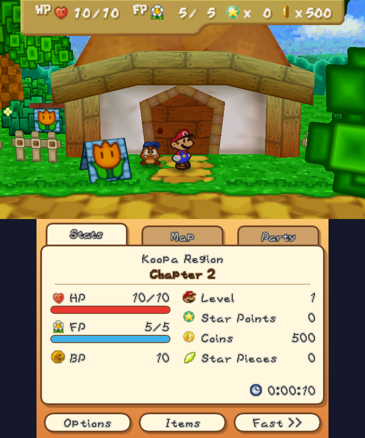
  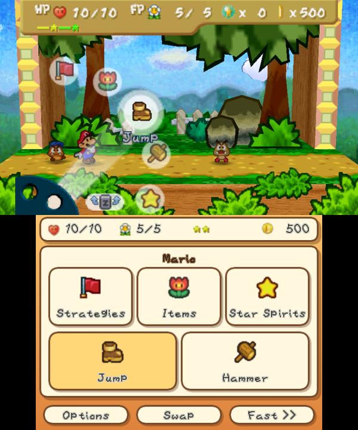

**Star Haven contains no game data.** You need your own Paper Mario ROM (EU or US).

## Install

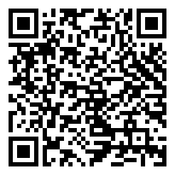

1. On a 3DS with custom firmware, open **FBI → Remote Install →
   Scan QR Code** and scan the code on the right. It always installs the newest release.
   You can also download `StarHaven.cia` or `StarHaven.3dsx` from
   [Releases](../../releases/latest).
2. Copy your ROM to the SD card as `/3ds/StarHaven/baserom.z64` (`.z64`, `.n64` and `.v64`
   all work).
3. Start Star Haven from the HOME menu.

Full instructions: [the player readme](port/3ds/RELEASE_README.md).

## Bring your N64 or Paperboat save

Got a Paper Mario save from Project64, RetroArch, ares, a flashcart or the Wii U Virtual
Console? Keep playing it on the 3DS:

- **In the game:** put the save in `/3ds/StarHaven/` as `import.fla` (a RetroArch `.srm` as
  `import.srm`) and start Star Haven. It converts the save and keeps your old one as
  `save.fla.bak`.
- **In a browser:** the [save converter](https://secondarylifer.github.io/StarHaven/converter/)
  turns an N64 save into a Star Haven `save.fla` / `save_us.fla`, and a Star Haven save back
  into an N64 one. Nothing is uploaded.
- **From Paperboat (PC):** drop its `file0.json` to `file3.json` into the same converter to get
  a `save_us.fla`, or a `save_us.fla` to get Paperboat files back (US ROM only, like Paperboat).

## Features

- EU and US versions in one package
- 60 fps (in-between frames are added), or the original 30
- Fast-forward and faster text
- Original, Fill or Wide screen, the 3D slider with a depth setting, remappable buttons
- A touch bottom screen with its tabs down the side:
  - **Stats**, with a quick-save button and what the area and the room you are in still hide
  - **Map**: the world map, showing where you are
  - **Party**: tap a partner to switch to them
  - **Tattle**: every enemy Goombario has tattled so far; tap one to read the whole tattle
  - **Found**: star pieces, badges, hidden blocks and panels and item spots collected in each area
  - **Recipes**: every dish Tayce T. cooks, the ones you've made, and how to make each one
  - plus Items, and in battle your HP, FP and Star Power down the side and the menus to tap:
    Mario's commands as big tiles with the game's icons, and targets picked on a live picture of the stage
- A randomizer, chosen when you start a new file, with a seed you can share
- Optional cheats (infinite HP, FP and Star Power, 999 coins, unlimited BP) for files started with them on (chosen once, when the file is made)
- Imports N64 saves (Project64, RetroArch, Wii U Virtual Console and others), and a
  [web converter](https://secondarylifer.github.io/StarHaven/converter/) for both directions,
  also to and from Paperboat
- 60 fps on the New 3DS family; about 30 fps on the original 3DS and 2DS, with a few extras
  off there (CIA only)
- Tells you on the bottom screen when a newer version is out (one check at start, nothing is
  downloaded; Options can turn it off)

| | | |
|:---:|:---:|:---:|
| 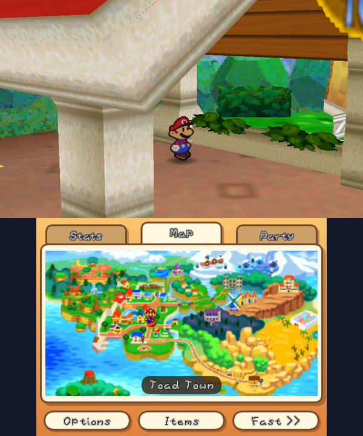 | 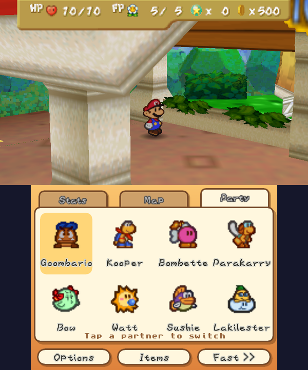 | 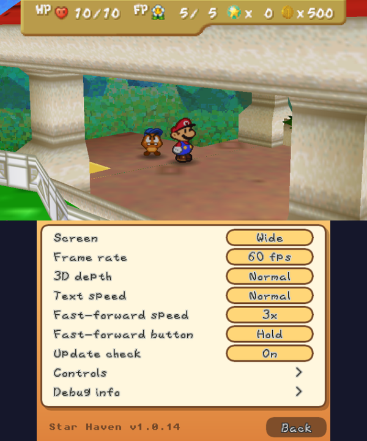 |
| World map | Party: tap a partner to switch | Options |
| 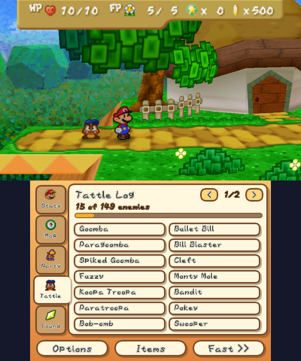 | 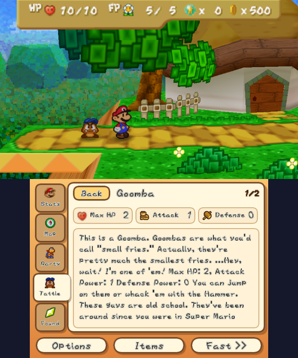 | 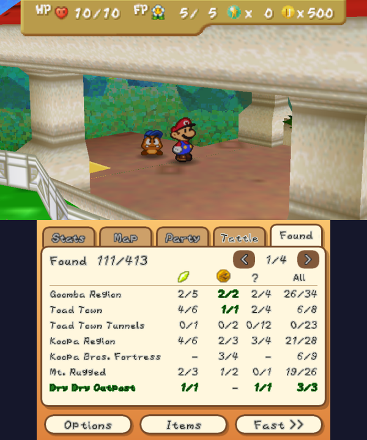 |
| Tattle log | Tap an enemy to read its tattle | Found: what you collected in each area |
| 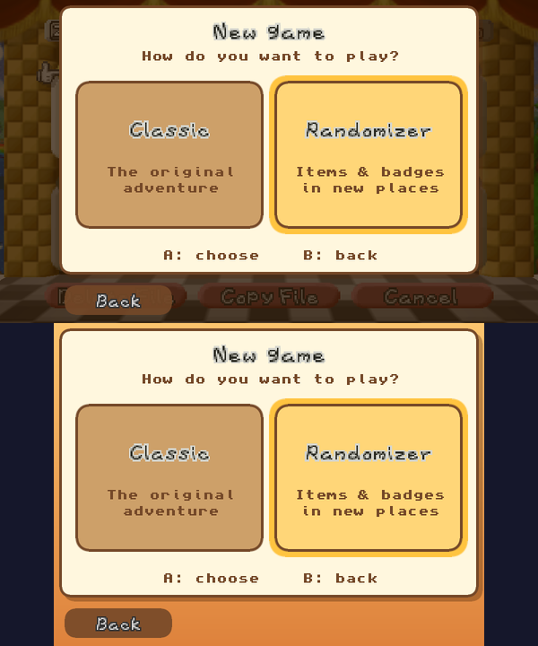 | 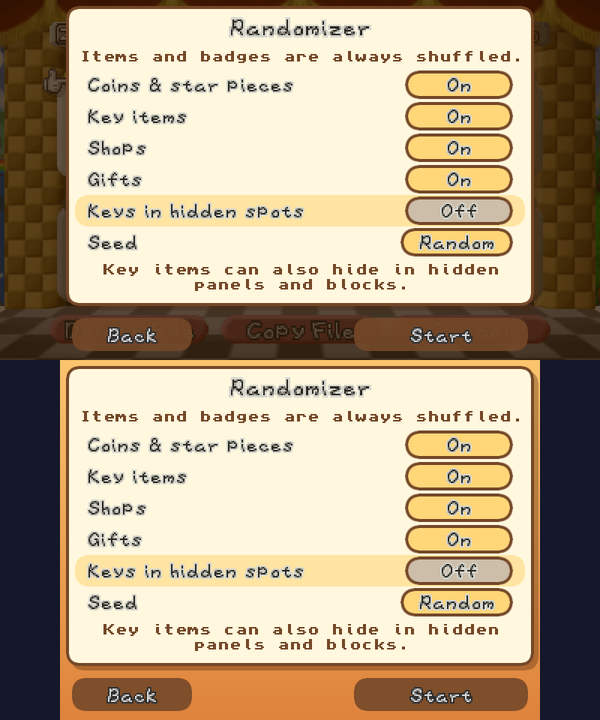 | |
| New file: Classic or Randomizer | What the randomizer shuffles | |

## Building

See [port/3ds/README.md](port/3ds/README.md). Everything builds in a Docker image with
devkitARM, libctru and citro3d, and needs your own ROMs in `ver/pal/` and `ver/us/`.

## Layout

| | |
|---|---|
| `port/3ds/` | the 3DS port: platform layer, renderer, audio, tools, packaging |
| `src/`, `include/`, `ver/` | the decompilation, with port changes under `#ifdef _3DS` |
| `DECOMP_README.md` | the decompilation's own readme |

## Credits

- 3D HOME Menu banner by [Velvii](https://github.com/Velvii) (model and animation; the star
  and the jingle are Star Haven's own). The title is in the Hey Gorgeous font, free for personal use.

## License

The port (everything under `port/3ds/` and the port's changes to the decompilation) is
licensed under the [Apache License 2.0](port/3ds/LICENSE), copyright 2026 SecondaryLifer. Forks
are welcome; keep the [NOTICE](port/3ds/NOTICE) file and credit Star Haven by SecondaryLifer.
The decompilation itself is [pmret/papermario](https://github.com/pmret/papermario).

## Legal

Star Haven is a fan project. It is not affiliated with or endorsed by Nintendo. *Paper Mario*
is a trademark of Nintendo. Release packages contain no Nintendo game data: images, models,
sounds and text are read from the player's own ROM at startup. The screenshots show the game
running on the port.
